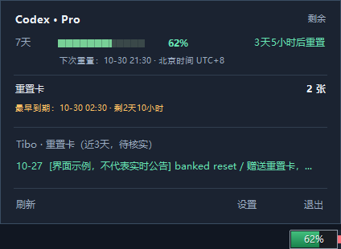

# Codex Battery · Codex 额度电量管家

**Windows 当前版本：1.0.0。** 用一个绿色小电池查看 Codex 额度、下次重置时间、可用重置卡及最早到期时间。

这是项目首次整理后的对外版本。此前本机开发过程中的临时编号不作为正式发行历史，后续有实际更新时才增加版本号。



截图使用合成数据，不代表真实公告或账号权益。

## 当前功能

- **绿色电池浮窗**：显示剩余百分比，支持拖动和位置记忆。
- **悬停详情**：按实际周期显示进度条、剩余比例、重置倒计时与具体时间；鼠标移入面板后可以继续点击。
- **重置卡**：显示实际可用张数，下一行显示最早到期时间和倒计时；不足3天黄色、不足24小时红色。
- **Tibo 消息**：每5分钟检查公开来源，只显示近3天与重置卡有关的候选帖子；单行摘要可打开 X 原帖，没有合格消息时隐藏消息区。
- **刷新与设置**：额度默认60秒刷新，可手动刷新；刷新时面板保留并原位更新。主窗口隐藏时也能直接打开设置。
- **托盘与后台**：关闭主窗口后继续运行；可隐藏浮窗、设置低额度提醒、选择显示周期、配置开机启动。
- **显示规则**：默认北京时间，可切换系统时区；失败、缺失或周期到期待确认时显示未知，不在本地补满额度或扣减卡数。

## Windows 使用

需要 Windows 10 / 11 自带的 .NET Framework 4.8，以及已安装、已登录的本机 Codex。查询需要联网，不要求填写密码、验证码或 API Key。

1. 直接运行本项目中的 `windows\dist\CodexQuotaManager.exe`，或解压 `artifacts\CodexBattery-windows-1.0.0.zip` 后双击 EXE。
2. 鼠标放到电池上查看详情；拖动电池改变位置；双击打开完整详情。
3. 通过悬停面板、浮窗右键或托盘右键进入设置。未找到 Codex 时手动选择 `codex.exe`。
4. 点击主窗口 X 只是收回托盘；右键托盘选择“退出管家”才会停止运行。

“托盘显示”选自动时，电池取 Codex 桶内剩余比例较低的有效周期；选固定周期时始终显示该周期。当前只有一个有效周期时两种选择结果相同。

详细说明见 [Windows 使用与构建](windows/README.md)。

## 只保留当前产物

```text
windows/dist/                              当前唯一的 Windows 程序目录
artifacts/CodexBattery-windows-1.0.0.zip     当前版本的便携包
```

程序目录始终使用 `dist`，更新时覆盖当前产物，不创建 `dist-v*` 目录。打包脚本成功生成新包后会清理旧 Windows ZIP。历史发行包如需保留，应放到仓库 Releases 或内部制品库，本机项目目录只保留最新版。

## 构建与版本

在仓库根目录打开 PowerShell：

```powershell
# 运行检查、构建并生成当前便携包
powershell -NoProfile -ExecutionPolicy Bypass -File .\scripts\package-windows.ps1
```

Windows 发布版本统一读取根目录 [VERSION](VERSION)，EXE 版本、主窗口版本、请求标识和 ZIP 文件名自动同步。当前为 **1.0.0**。

| 后续变化 | 版本示例 |
| --- | --- |
| 修复问题，功能兼容 | 1.0.1 |
| 增加兼容功能 | 1.1.0 |
| 不兼容的大改动 | 2.0.0 |

日常重新构建、整理文档不自动递增版本；确定发布实际更新时才修改版本。详见[版本约定](docs/VERSIONING.md)、[更新记录](CHANGELOG.md)、[验证记录](docs/VALIDATION.md)。

## macOS 状态

仓库包含 Swift + AppKit 的 **0.1.0 实验源码**、测试和 `.app` 打包脚本，目标 macOS 13+。尚未在 Mac 编译或真机验证，不包含可承诺正常运行的 Mac 正式发行包；重置卡到期行等 Windows 功能尚未全部移植。

Mac 上的构建和验证步骤见 [macOS 说明](macos/README.md)。Windows 的1.0.0发布不代表Mac已正式发布。

## 数据与隐私

账号额度通过本机 Codex App Server 查询，由 Codex 处理已有登录；本工具不直接打开或记录登录令牌，不创建对话或兑换卡。

重置卡数量来自账号实际返回的总数。到期时间只有在完整有效的可用卡详情返回时才计算，否则显示待确认。

Tibo 来源为第三方公开 RSS / 索引，可能延迟、漏帖或停更。消息不是卡到账凭证，以 X 原帖和账号实际数据为准。

本地配置继续保存在 `%LOCALAPPDATA%\CodexQuotaManager`；版本整理不迁移或清空设置。源码仓库忽略构建产物、真实账号输出、运行配置和凭据。

## 文档与项目

- [Windows 使用与构建](windows/README.md) · [macOS 使用与构建](macos/README.md)
- [架构与平台功能表](docs/ARCHITECTURE.md) · [数据来源](docs/DATA-SOURCES.md)
- [隐私与本地文件](docs/PRIVACY.md) · [故障排查](docs/TROUBLESHOOTING.md)
- [开发与 Git 提交](CONTRIBUTING.md) · [发布步骤](docs/RELEASING.md)

仓库名称 `codex-battery`。本项目为独立本地工具，与 OpenAI 没有隶属关系。布局参考 [claude-codex-battery](https://github.com/dennykim123/claude-codex-battery)，自行实现，没有复制其源文件。

当前未指定开源许可证，参见 [NOTICE.md](NOTICE.md)。
