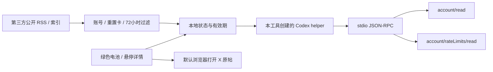

# 架构与平台边界

## 目录与技术选择

仓库名 `codex-battery`，产品名 Codex Battery，中文名 Codex 额度电量管家。

Windows 继续使用 C# / WinForms / .NET Framework 4.8，保留已验证的界面和进程清理逻辑。macOS 使用 Swift / AppKit / Swift Package Manager，提供菜单栏、NSPanel 浮窗和原生设置窗口。

两端各自编译，避免为共享 UI 引入体积较大的运行环境。当前没有共享可执行代码；协议、展示规则和测试场景以文档对齐，修改时需要检查两端。

## 查询链路

每次额度查询创建新的 helper，完成初始化后读取账号、额度，再次读取账号以检查查询期间账号是否变化。两端都不调用创建对话、切换账号或兑换重置卡的方法。

额度和消息各自刷新，消息源故障不会阻塞额度刷新。界面倒计时本地更新，账号实际周期只能由服务端响应确认。

## 进程与退出

Windows 使用 Job Object 管理本工具创建的 helper 及其子进程，退出时关闭该 Job，不按进程名批量结束其他 Codex。

macOS 记录本工具创建的 `Process`，请求完成、失败、取消或退出时向该 helper 发送终止，必要时只对该仍在运行的 Process 发送 SIGKILL。macOS 首版没有 Windows Job Object 等价的整棵进程树管理；正常查询不会创建聊天或任务子进程，进程清理仍需要在 Mac 实测。

macOS 配置变化使用版本号丢弃旧查询结果，避免保存新配置后旧查询覆盖新状态。到期补刷新按窗口与重置时间去重，不每秒重复创建 helper。

## 平台功能表

| 功能 | Windows 1.0 | macOS 0.1 实验版 |
| --- | --- | --- |
| 绿色电池、拖动、位置记忆 | 已验证 | 已实现，待 Mac 验证 |
| 悬停概要、周期进度条、具体重置时间 | 已验证 | 已实现，待 Mac 验证 |
| 实际可用重置卡数量 | 已验证 | 已实现，待真实账号验证 |
| 重置卡最早到期时间 | Windows 1.0.0 支持 | 暂未实现 |
| Tibo 近 72 小时重置卡消息 / 原帖链接 | 已实现，消息源可能过旧 | 已实现，待 Mac 验证 |
| 默认北京时间 / 系统时区 | 已验证 | 已实现，待 Mac 验证 |
| 托盘 / 菜单栏入口 | 已验证 | 已实现，待 Mac 验证 |
| 单独的完整详情窗口 | 支持 | 暂无，使用概要面板 |
| 手动选择小电池对应周期 | 支持 | 暂无，固定自动选择 |
| 低额度系统通知 | 支持，受系统设置影响 | 暂无 |
| 应用内开机启动设置 | 支持，默认关闭 | 暂无，可用系统登录项 |
| 刷新间隔设置 | 30～3600 秒，默认 60 秒 | 固定 60 秒 |
| 多设备 / 全部 DPI 验证 | 未完成 | 未完成 |

## 版本与兼容

Windows 内部命名、EXE 名、互斥量及 `%LOCALAPPDATA%\CodexQuotaManager` 保留，避免既有用户丢失配置。macOS 使用 `local.codexbattery.app` 和独立本地目录。两端不共享凭据或自动同步配置。

目前平台版本分别维护：Windows 1.0.0，macOS 0.1.0。发布时在发布标题和产物名中标明平台，避免把实验性 Mac 版本误认为 Windows 的等价稳定版本。
